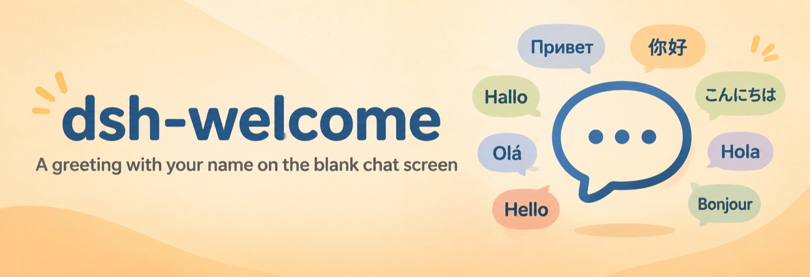
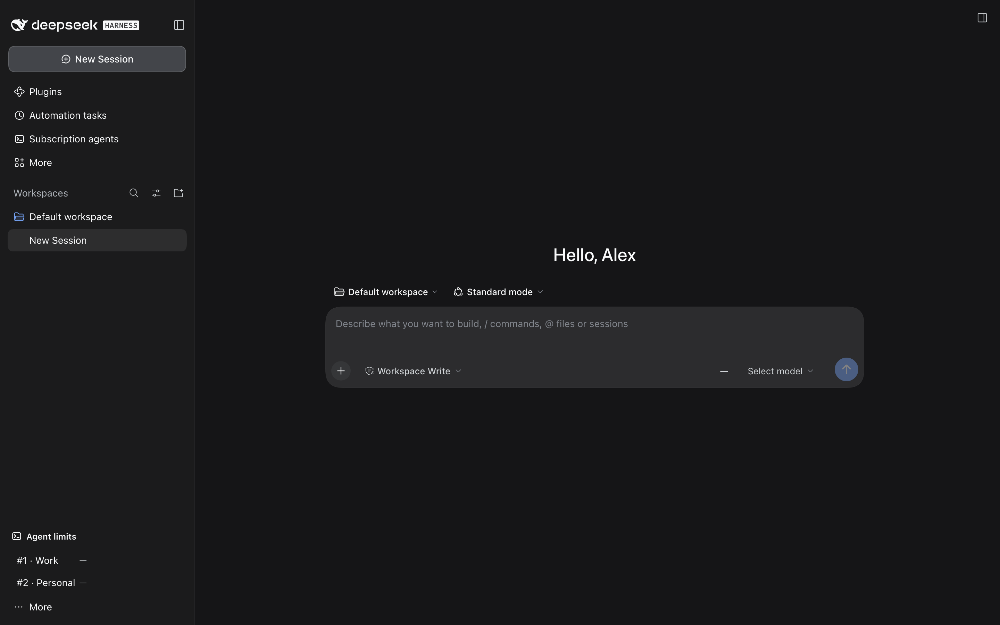
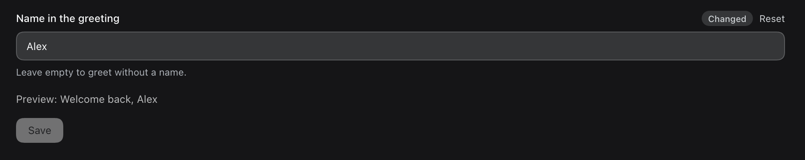

<p align="center">
  
</p>

<p align="center">
  <a href="https://github.com/adsqwui/dsh-welcome/actions/workflows/test.yml"></a>
  <a href="https://www.npmjs.com/package/@adsqwui/dsh-welcome"></a>
  
  
  
  <a href="LICENSE"></a>
  <a href="CONTRIBUTING.md"></a>
</p>

<p align="center">
  A small <a href="https://github.com/deepseek-ai/deepseek-harness">DeepSeek Harness</a> plugin that greets you by name every time you open a new chat.
</p>

---

<p align="center">
  
</p>

## Features

- **A greeting instead of the logo.** The blank chat screen shows one of five greetings in place of the logo, headline and Preview badge.
- **Your name, if you want it.** "Welcome back, Alex" with a name, "Welcome back" without one.
- **Eight languages.** Russian, English, Chinese, Japanese, Spanish, French, German and Brazilian Portuguese. Other interface languages follow DSH's fallback chain.
- **Stable while you type.** A greeting is picked when the screen opens and stays put. Switching the interface language translates it in place.
- **Settings in Plugins.** Change the name on the plugin's page with a live preview. Saved changes show up on the next blank chat, no restart.
- **Touches nothing else.** Models, messages, credentials and session history are left alone. Turn the plugin off and the stock screen is back.

## Install

In DSH open **Plugins → Add plugin**, enter the package name, install and enable it:

```text
@adsqwui/dsh-welcome
```

From a terminal the same is `dsh plugin --profile <profile> add @adsqwui/dsh-welcome`.

To work on the code instead, clone the repository and give **Add plugin** the absolute path of the folder. DSH links to it, so `git pull` and a restart are all an update takes.

## Set your name

Open **Plugins**, then the **Welcome greeting** page. Type a name, check the preview and press **Save**.

<p align="center">
  
</p>

The next blank chat uses the new name. Clear the field and save to go back to greetings without a name. Names longer than 40 characters are refused; extra spaces and control characters are dropped.

DSH stores the value in your profile's `cordis.patch.yml` (on macOS Desktop: `~/.dsh/profiles/desktop/cordis.patch.yml`), not in the plugin folder, so `git pull` never overwrites it. You can also set it there by hand:

```yaml
- id: dsh-welcome
  name: '@adsqwui/dsh-welcome'
  config:
    name: Alex
```

## How it works

| Part | What it does |
|---|---|
| `index.js` | Declares `Config.name` as a volatile setting, which is what puts the field on the Plugins page and lets it change without a restart |
| `host.js` | Serves the current, cleaned name over a small RPC route |
| `client.js` | Renders the greeting through the `conversation.hero.brand.mark` slot and the settings card through `plugins.bundle.config`, using DSH's own `SettingsForm` controls |

If the settings service or its form controls are missing, only the greeting registers and it still reads the name from the profile.

The CSS that hides the stock headline matches the DSH 0.2.2 hero markup by class-name fragments. If a future redesign changes that markup, the greeting still shows, but the stock headline may appear next to it until the selectors in `client.js` are updated.

## Development

```bash
npm test
```

The tests load `client.js` the way the DSH module loader does, with fake React, slots and settings services, and check every language, the name rules, the settings card and the Host route. CI runs them on Node 22 and 24 on Linux and macOS.

Want another language? Add a block to `dictionaries` and `settings` in `client.js` and its code to the language list in `tests/welcome.test.js`; the tests then tell you if a key is missing.

## Contributing

Pull requests are welcome, especially new languages and greetings. See [CONTRIBUTING.md](CONTRIBUTING.md).

## License

[MIT](LICENSE). The speech-bubble icon is original artwork made for this plugin. Not affiliated with DeepSeek.
